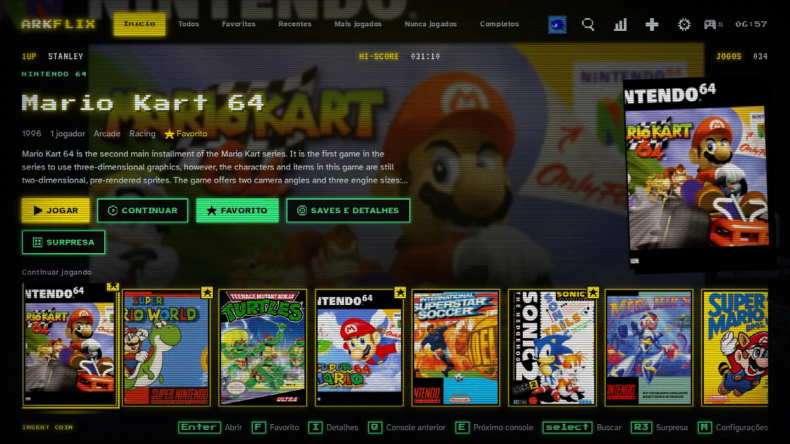

# arkflix-games

[](https://github.com/stanleygomes/arkflix-games/releases)
[](https://github.com/stanleygomes/arkflix-games/actions/workflows/release.yml)



App de biblioteca de jogos para Linux, Windows e macOS (Go + Svelte), feito
para controle e TV. Os jogos abrem no [RetroArch](https://www.retroarch.com)
com oito cores, no [PPSSPP](https://www.ppsspp.org) e no
[PCSX2](https://pcsx2.net): no Linux, os do [Flathub](https://flathub.org); no
Windows e no macOS, os dos instaladores oficiais. Este repositório é só o app;
os emuladores vêm prontos.

## Sumário

- [Recursos](#recursos)
- [Compatibilidade](#compatibilidade)
- [Requisitos](#requisitos)
- [Instalação](#instalação)
- [Uso](#uso)
- [O app](#o-app)
- [Compilação](#compilação)
- [Emuladores](#emuladores)
- [Testes](#testes)
- [Versionamento e releases](#versionamento-e-releases)
- [Página de download](#página-de-download)
- [Estrutura do repositório](#estrutura-do-repositório)
- [Solução de problemas](#solução-de-problemas)
- [Contribuindo](#contribuindo)
- [Licença](#licença)

## Recursos

- Navegação de console (estilo PS5) e visual 16-bit: biblioteca por console,
  busca, filtros, coleções, listas, estatísticas e importação de ROMs.
- Pontos salvos com miniatura, mídia em tela cheia, vídeo do jogo e protetor de
  tela retrô.
- Perfis estilo Netflix, com PIN opcional e modo infantil.
- Configuração de controle com prévia ao vivo e opções de acessibilidade.
- Guia rápido no botão Home, até por cima do jogo: voltar, salvar ou carregar
  estado e fechar o jogo.
- Central de downloads e avisos, com cancelar e histórico.
- Conquistas do RetroAchievements por perfil, com troféus na página do jogo.
- Descrição, ano e gêneros que faltam vindos do Wikidata e da Wikipedia
  (abertos, sem conta), no editor do jogo ou em lote.
- Pareamento de controle Bluetooth pela tela (Linux).
- Emuladores instalados e atualizados pelo próprio app, nos três sistemas.
- Atualização automática do app pela última release.
- Busca global (jogos, consoles, listas e configurações), sons de interface,
  tela de boot e modo descanso.
- Emuladores do Flathub: mesma configuração, saves e BIOS de quem já usa os
  Flatpaks.
- Testes automatizados do app (Go, interface e ponta a ponta com axe).
- Versão semântica e changelog gerados a partir de Conventional Commits.
- Instalação em um comando.

## Compatibilidade

| | Linux | Windows | macOS |
| --- | --- | --- | --- |
| Versões | Ubuntu 26.04 ou Debian equivalente | 10 e 11, 64 bits | 11 ou mais novo |
| Processador | x86_64 | x86_64 | Intel e Apple Silicon (universal) |
| Instalação | `install.sh` (um comando) ou `.tar.gz` | instalador `.exe` ou `.zip` portátil | `.dmg` |
| Janela | WebKitGTK | WebView2 (já vem no Windows 10/11) | WebKit do sistema |
| Controle | lido direto do kernel (evdev) | Gamepad API do WebView2 | Gamepad API do WebKit |
| Emuladores | Flatpaks (`make emulators` instala) | instaladores oficiais | instaladores oficiais |
| Cores do RetroArch | baixados pelo `make emulators` | pelo RetroArch (Online Updater) | pelo RetroArch (Online Updater) |
| Biblioteca, perfis, modo infantil, RomM, estatísticas | sim | sim | sim |
| Saves com miniatura e sincronização com o RomM | sim | sim | sim |
| Atalhos iguais nos emuladores (Esc / F10) | sim | sim | sim |
| Scripts de evento | executáveis (`.sh`...) | `.bat`, `.cmd`, `.ps1`, `.exe` | executáveis |
| Testado em máquina real | sim | ainda não | ainda não |

No Windows e no macOS o app é compilado e passa nos testes automatizados a cada
release, mas ainda não foi testado com controle e jogo de verdade nesses
sistemas. O macOS avisa que o app é de "desenvolvedor não identificado" (não é
assinado pela Apple): na primeira vez, clique com o botão direito no app e
escolha **Abrir**.

## Requisitos (Linux)

| Item | Detalhe |
| --- | --- |
| Sistema | Ubuntu 26.04 ou Debian equivalente, x86_64 |
| Disco | cerca de 15 MB para o app; os Flatpaks dos emuladores, cerca de 1,5 GB |
| Ferramentas | `git`, `make`, `curl` e `python3` (o instalador cuida do resto) |
| Para compilar o app | Go 1.26 ou mais recente e Node.js 20 ou mais recente |
| Permissão | `sudo` para instalar os pacotes do apt |
| Opcional | BIOS do PlayStation e do PlayStation 2, que não são distribuídas aqui |

## Instalação

Os instaladores de cada sistema ficam na
[página de releases](https://github.com/stanleygomes/arkflix-games/releases/latest).
Links diretos, sempre da última versão:

| Sistema | Download |
| --- | --- |
| Windows (instalador) | [arkflix-games-windows-x86_64-setup.exe](https://github.com/stanleygomes/arkflix-games/releases/latest/download/arkflix-games-windows-x86_64-setup.exe) |
| Windows (portátil) | [arkflix-games-windows-x86_64.zip](https://github.com/stanleygomes/arkflix-games/releases/latest/download/arkflix-games-windows-x86_64.zip) |
| macOS | [arkflix-games-macos-universal.dmg](https://github.com/stanleygomes/arkflix-games/releases/latest/download/arkflix-games-macos-universal.dmg) |
| Linux | [arkflix-games-linux-x86_64.tar.gz](https://github.com/stanleygomes/arkflix-games/releases/latest/download/arkflix-games-linux-x86_64.tar.gz) |

**Windows.** Baixe `arkflix-games-<versão>-windows-x86_64-setup.exe` e rode (não
pede administrador; instala em `%LOCALAPPDATA%\Programs\arkflix-games`, com
atalho no Menu Iniciar). Instale também o
[RetroArch](https://www.retroarch.com/?page=platforms) (no lugar padrão,
`C:\RetroArch-Win64`), o [PPSSPP](https://www.ppsspp.org/download/) e o
[PCSX2](https://pcsx2.net/downloads/), e baixe os cores pelo RetroArch (menu
Online Updater › Core Downloader: Snes9x, Genesis Plus GX, Mesen, Gambatte,
Mupen64Plus-Next, Beetle PSX, FinalBurn Neo e melonDS DS). Emulador instalado em
outro lugar: informe o caminho em Configurações › Biblioteca › Emuladores e saves.

**macOS.** Baixe `arkflix-games-<versão>-macos-universal.dmg`, arraste o app para
Aplicativos e, na primeira vez, abra com o botão direito › Abrir. Instale o
RetroArch, o PPSSPP e o PCSX2 em Aplicativos e baixe os cores pelo RetroArch,
como no Windows.

**Linux.** Um comando instala tudo, emuladores incluídos:

```bash
curl -fsSL https://raw.githubusercontent.com/stanleygomes/arkflix-games/master/install.sh | bash
```

O instalador:

1. instala as dependências pelo apt (incluindo o Flatpak);
2. clona o repositório em `~/.local/share/arkflix-games` ou o atualiza, se já
   existir;
3. instala o RetroArch, o PPSSPP e o PCSX2 do Flathub (no usuário) e baixa os
   oito cores do RetroArch (`make emulators`);
4. baixa o app do release mais recente que o tenha e confere o SHA-256; se
   nenhum release tiver o app, compila (cerca de um minuto);
5. cria o comando `arkflix-games` em `~/.local/bin`.

Executar o instalador de novo atualiza a instalação. As opções são variáveis de
ambiente, passadas antes do `bash`:

| Variável | Efeito |
| --- | --- |
| `ARKFLIX_GAMES_DIR` | pasta da instalação (padrão: `~/.local/share/arkflix-games`) |
| `ARKFLIX_GAMES_BUILD=1` | compila o app mesmo que exista release com binários |
| `ARKFLIX_GAMES_NO_DEPS=1` | não instala pacotes do apt |

```bash
curl -fsSL https://raw.githubusercontent.com/stanleygomes/arkflix-games/master/install.sh \
  | ARKFLIX_GAMES_DIR=~/emulacao bash
```

## Uso

```bash
arkflix-games       # após a instalação
make run            # dentro do repositório
```

O app abre em tela cheia; F11 alterna. O botão de energia, no topo, minimiza,
sai da tela cheia ou fecha o app (com confirmação), também pelo controle.
`--windowed` (ou `make run ARGS=--windowed`) abre em janela.

O app procura jogos em `~/Games/roms/<console>/` (`snes/`, `psx/`, `ps2/`...) e
traz ROMs de qualquer outra pasta pela tela de importação. As BIOS ficam nas
pastas dos Flatpaks (veja [Emuladores](#emuladores)); Configurações ›
Emuladores › BIOS mostra o que falta de cada console e abre a pasta certa.

## O app

Interface pensada pra controle, com cara de fliperama: fundo de tubo de TV com
scanlines, contorno neon com brilho na cor de cada console, letreiro e placar
(1UP, HI-SCORE) na fonte de arcade, seleção em amarelo e INSERT COIN piscando.
Títulos e rótulos na Press Start 2P; texto corrido na Atkinson Hyperlegible, de
leitura fácil. Sons de menu e trilha chiptune, tudo desligável.

| Tela | O que faz |
| --- | --- |
| Início | Consoles no topo; jogo em destaque com capa, ano, jogadores e descrição; fileira de jogos embaixo. No Início: "Continuar jogando" e "Favoritos" |
| Jogo | Jogar do início, continuar de onde parou, favoritar, mídia em tela cheia (capa, prints, miniaturas dos saves e manual em PDF) e os pontos salvos com miniatura: carregar ou apagar (com confirmação) |
| Importar | Arquivos ou pastas de qualquer lugar: detecta o console (extensão, conteúdo do zip, ISO de PSP/PS2), avisa o que não dá e copia pra `~/Games/roms` |
| Configurações | Pastas de jogos, controle (prévia ao vivo e remapeamento botão a botão, controle ou teclado), acessibilidade e atalhos |

**Controles.** Xbox, PlayStation, 8BitDo e teclado. O app lê o controle direto do
kernel (evdev), reconhece o fabricante e mostra os símbolos certos (A/B, ✕/○).
Confirma com o botão de baixo, volta com o da direita; L1/R1 trocam de console.
Dentro do jogo, igual em todos os emuladores: Esc ou Select + botão de cima
abre o menu do emulador (pausa, salvar, carregar); F10 ou Select + Start sai e
volta pro app. Fora do PSP e do PS2, Select + R salva e Select + L carrega. No
PPSSPP e no PCSX2 do Flatpak, o app ajusta só esses atalhos e a saída (sem
pergunta de confirmação; "sair" no menu de pausa fecha o emulador) e guarda o
arquivo original como `<arquivo>.arkflix-backup`. Esses dois só ficam ajustados
depois de abertos uma vez (o PCSX2 pede a BIOS no primeiro uso). Num jogo
aberto pelo app, o RetroArch não grava a config ao sair: um ajuste feito no
menu dele nessa hora vale só pra sessão.

**Acessibilidade.** Texto de 100% a 175%, alto contraste (preto, branco e amarelo),
reduzir animações, títulos sem fonte pixel e a fonte Atkinson Hyperlegible,
desenhada para baixa visão, em todo o texto corrido. Toda tela é testada com o
[axe](https://github.com/dequelabs/axe-core) (WCAG 2.1 AA) e toda paleta de console
tem contraste AA verificado em teste.

**Capas e descrições.** Com "Baixar capas" ligado (configurações da biblioteca),
o app baixa capa, print e tela de título do acervo aberto do RetroArch
([thumbnails.libretro.com](https://thumbnails.libretro.com)), sem conta: o jogo é
reconhecido pelo CRC da ROM (cartuchos), pelo serial do disco (PS1, PS2, PSP) ou
pelo nome do zip (arcade), usando o banco do libretro, e tudo fica em cache em
`~/.cache/arkflix-games`. Uma imagem com o nome do jogo em
`<pasta>/<console>/covers/` tem prioridade (prints em `screenshots/` e manual em
`manuals/<nome>.pdf` também entram, e um vídeo em `videos/<nome>.mp4` toca
mudo no fundo do Início depois de 2 s parado no jogo), assim como os `gamelist.xml` e a
mídia de uma instalação antiga do ES-DE em `~/ES-DE`, se existir. Sem capa, o app
desenha o cartucho, disco ou UMD do console com o título.

**Protetor de tela.** Depois de alguns minutos parado (5 por padrão, ajustável
ou desligável), a cobrinha joga sozinha em fósforo verde, ou as capas passam
como no attract mode de um fliperama. Nunca liga com jogo aberto; qualquer botão,
tecla ou clique só acorda a tela, sem executar a ação.

**Scripts de evento.** Executáveis em
`~/.config/arkflix-games/scripts/game-start/` e `.../game-end/` rodam em segundo
plano ao abrir e ao fechar um jogo, em ordem alfabética, recebendo o caminho da
ROM, o nome e o console (ao fechar, também os segundos jogados). Saída em
`~/.config/arkflix-games/logs/scripts.log`. Exemplo: backup dos saves ao fechar o
jogo.

```sh
#!/bin/sh
# ~/.config/arkflix-games/scripts/game-end/backup.sh
rsync -a --update ~/.var/app/org.libretro.RetroArch/config/retroarch/saves/ /mnt/backup/saves/
```

**Servidor RomM.** Em Configurações > Servidor, entre no seu
[RomM](https://romm.app) (endereço, usuário e senha). A senha só é usada no
login: o app cria um token próprio no RomM ("arkflix-games (<computador>)") e
guarda só ele, em `~/.config/arkflix-games/romm.json` (permissão 600). Os jogos
do servidor aparecem na biblioteca com um selo de nuvem e na coleção
"Servidor"; "Baixar do servidor" copia o jogo pra `~/Games/roms/<console>/`
(confere o espaço em disco antes). Os saves do RetroArch do perfil que conectou
sincronizam sozinhos: antes de jogar, desce o que estiver mais novo no servidor;
ao fechar, sobe o que mudou. Um arquivo daqui nunca é trocado por um mais velho.
Saves de PSP e PS2 não sincronizam. Sem internet, os jogos baixados abrem
normalmente. HTTP sem TLS só é aceito pra servidor nesta máquina.

**Primeira vez.** O app abre numa tela de entrada, em tela cheia: entrar com o
servidor RomM (endereço, usuário e senha) ou jogar offline. Em seguida, monta o
perfil.

**Perfis.** Na primeira vez, o app pede nome e avatar (34 personagens clássicos,
de Pac-Man e Mario a Sonic e Mega Man, ou um desenho em pixel art). Com mais de
um perfil, abre em "Quem vai jogar?" (avatar, cor e PIN opcional de 4 números). Cada perfil tem os próprios
favoritos, listas, histórico, estatísticas, acessibilidade, mapeamento de
controle e saves do RetroArch. Saves de PSP e PS2 são compartilhados: o PPSSPP e
o PCSX2 não deixam trocar a pasta de saves por linha de comando. Troque de
perfil pelo avatar no topo.

**Modo infantil.** Um perfil pode ser marcado como infantil na edição do perfil.
Nele só aparecem os jogos liberados ("Liberado no perfil infantil", no editor de
cada jogo), os botões ficam maiores e não há configurações, importação, apagar
saves nem edição de metadados, nem por atalho nem pela API. Para sair dele, vale
o PIN do perfil adulto: defina um.

**Dados.** Configurações, favoritos e tempo de jogo ficam em
`~/.config/arkflix-games`. O primeiro perfil usa essa pasta (quem já usava o
app não perde nada); os outros ficam em `profiles/<id>/`, com os saves do
RetroArch em `profiles/<id>/saves/retroarch/`. Apagar um perfil move a pasta
dele para `profiles/apagados/`. Os saves do primeiro perfil continuam nas pastas
dos emuladores.

### Arquitetura

```text
app/
├── main.go, desktop.go     janela (Wails/WebKitGTK) ou servidor web (--web)
├── internal/
│   ├── core/               API do app; tudo que a interface chama
│   ├── library/ meta/ saves/  fonte de jogos, metadados e saves (implementações locais)
│   ├── importer/ archive/ isoinfo/  importação: detecção e cópia
│   ├── launcher/           comando de cada emulador
│   ├── gamepad/ input/     controle (evdev) e mapeamento pro RetroArch
│   ├── httpapi/            a mesma API por HTTP + eventos (SSE)
│   └── fixture/            ambiente falso dos testes
└── web/                    interface: Svelte 5 + TypeScript
```

A interface fala com o Go por uma API única: no desktop pelo Wails, no navegador
por `POST /api/call/<Método>` e eventos em `/api/events`. A fonte de jogos, os
metadados e os saves entram no núcleo por interface (`GameSource`, `MetaProvider`
e `SaveStore`), hoje com implementações locais. Levar a biblioteca e os saves
pra um servidor é escrever outras implementações dessas três interfaces e servir
a mesma API: a interface e o resto do núcleo não mudam.

Pra mexer na interface: `make run-web` sobe o app em http://127.0.0.1:8484 e
`cd app/web && npm run dev` recarrega a cada mudança (a API vem do Go).

## Compilação

```bash
git clone https://github.com/stanleygomes/arkflix-games.git
cd arkflix-games
make deps        # pacotes via apt (requer sudo)
make emulators   # Flatpaks dos emuladores e cores do RetroArch
make app         # compila o app em build/prefix/bin/arkflix-games
make check       # executa os testes
make run         # abre o app
```

`make help` lista todos os alvos.

## Emuladores

O app não compila nem altera emulador: abre cada jogo com `flatpak run`, usando
a configuração, os cores, os saves e as BIOS dos Flatpaks. Quem já jogava pelos
Flatpaks continua com tudo.

| Sistema | Emulador (Flathub) | Core |
| --- | --- | --- |
| NES | `org.libretro.RetroArch` | Mesen (`mesen`) |
| SNES | `org.libretro.RetroArch` | Snes9x (`snes9x`) |
| Game Boy e Game Boy Color | `org.libretro.RetroArch` | Gambatte (`gambatte`) |
| Mega Drive | `org.libretro.RetroArch` | Genesis Plus GX (`genesis_plus_gx`) |
| Nintendo 64 | `org.libretro.RetroArch` | Mupen64Plus-Next (`mupen64plus_next`) |
| Nintendo DS | `org.libretro.RetroArch` | melonDS DS (`melondsds`) |
| PlayStation | `org.libretro.RetroArch` | Beetle PSX (`mednafen_psx`) |
| Arcade | `org.libretro.RetroArch` | FinalBurn Neo (`fbneo`) |
| PlayStation Portable | `org.ppsspp.PPSSPP` | |
| PlayStation 2 | `net.pcsx2.PCSX2` | |

O `make emulators` instala os Flatpaks no usuário (sem sudo), baixa os cores que
faltarem do [buildbot do libretro](https://buildbot.libretro.com) para a pasta de
cores do RetroArch e libera leitura da home pro PCSX2, cujo Flatpak não enxerga
os jogos por padrão. Rodar de novo só instala o que falta; atualizar os
emuladores é com `flatpak update`.

O mesmo dá pra fazer de dentro do app: **Você › Emuladores** instala o que falta
ou atualiza tudo. No Windows e no macOS, baixa os pacotes oficiais (RetroArch do
buildbot, PPSSPP do ppsspp.org, PCSX2 do GitHub) e os cores do buildbot.

| Emulador | Saves e BIOS |
| --- | --- |
| RetroArch | `~/.var/app/org.libretro.RetroArch/config/retroarch/{saves,states,system}` |
| PPSSPP | `~/.var/app/org.ppsspp.PPSSPP/config/ppsspp/PSP` |
| PCSX2 | `~/.var/app/net.pcsx2.PCSX2/config/PCSX2/{memcards,sstates,bios}` |

No RetroArch, o app acrescenta à configuração do Flatpak só o mapeamento da tela
de controles, nos perfis extras as pastas de save do perfil, a conta do
RetroAchievements (se o perfil entrou) e, no Linux, a porta de comandos local
que o guia usa pra salvar, carregar e fechar o jogo (`--appendconfig`).

## Testes

`make check` executa todas as verificações e falha se qualquer uma falhar.

| Alvo | Verificação |
| --- | --- |
| `check-app` | `go vet`, testes Go com detector de race, tipos (svelte-check), testes unitários da interface, testes de ponta a ponta no Chromium com axe em toda tela e, se o app desktop estiver compilado, a janela de verdade |
| `check-emulators` | os três Flatpaks e os oito cores estão instalados |

Os testes de ponta a ponta sobem o app com um ambiente falso (`--fixture`):
biblioteca, saves e emuladores que só registram a chamada.

## Versionamento e releases

O projeto segue [Versionamento Semântico](https://semver.org/lang/pt-BR/) e
[Conventional Commits](https://www.conventionalcommits.org/pt-br/). A cada push
no `master`, o workflow `release.yml` executa `bin/release.sh --publish`, que
analisa os commits desde a última tag:

| Commits desde a última tag | Incremento |
| --- | --- |
| `tipo!:` ou rodapé `BREAKING CHANGE:` | major |
| `feat` | minor |
| `fix` ou `perf` | patch |
| apenas `docs`, `chore`, `test`, `ci`, `refactor`, `style` ou `build` | nenhum release |

O release é criado com a tag `vX.Y.Z`, um changelog agrupado por tipo e uma
tabela de downloads. Em seguida, o mesmo workflow gera e anexa os instaladores
de cada sistema (`bin/package.sh`): o `.tar.gz` do Linux, o instalador `.exe` e
o `.zip` do Windows (compilados no Linux, sem cgo) e o `.dmg` universal do macOS
(compilado num Mac do GitHub). Cada arquivo vai com o seu `.sha256`.

| Comando | Função |
| --- | --- |
| `make release-notes` | mostra a próxima versão e o changelog, sem publicar |
| `make package OS=linux\|windows\|macos` | gera o instalador de um sistema em `build/dist` |
| `make release-binaries` | plano B: gera os pacotes de Linux e Windows daqui e anexa na tag do HEAD |
| `make release-install` | baixa e verifica o app do release mais recente que o tenha (`RELEASE=vX.Y.Z` fixa um) |

Pra gerar os instaladores de uma tag que já existe, rode o workflow `release`
manualmente no GitHub (Actions › release › Run workflow) informando a tag.

## Página de download

`site/` é a página de download (HTML, CSS e JS puros, com as fontes e as cores do
app). Na Vercel: importe o repositório e, em **Root Directory**, escolha `site`
(sem build). Os botões apontam sozinhos pros arquivos da última release, pela API
pública do GitHub, e destacam o sistema de quem visita. Pra ver localmente:
`python3 -m http.server -d site 8080`.

## Estrutura do repositório

```text
.
├── .github/workflows/  release automático
├── app/                o app: backend Go (app/internal) e interface (app/web)
├── bin/                scripts: versão, empacotamento e download de release
├── packaging/          instalador do Windows (NSIS) e Info.plist do macOS
├── site/               página de download (Vercel)
├── install.sh          instalador em um comando
└── Makefile            ponto de entrada de todas as tarefas
```

`build/` (compilação) é gerado e ignorado pelo Git.

## Solução de problemas

**O app não reconhece o controle.** Veja se ele aparece em
`/proc/bus/input/devices`. O sistema libera `/dev/input/event*` pro usuário
logado quando o dispositivo é um controle; se não liberar, adicione o usuário ao
grupo `input`. Conectar com o app aberto funciona (ele procura a cada 2 s).

**`make app` reclama do WebKitGTK.** Faltam os pacotes de desenvolvimento:
`make deps`.

**O app diz que falta um emulador ou um core.** `make emulators` instala o que
faltar; `make check-emulators` mostra o que está instalado.

**Jogos de PS2 não abrem.** O Flatpak do PCSX2 só lê a home com a liberação do
`make emulators` (`flatpak override --user --filesystem=host:ro net.pcsx2.PCSX2`).
Ele também exige uma BIOS em `~/.var/app/net.pcsx2.PCSX2/config/PCSX2/bios`.

**Jogos de PlayStation não iniciam.** O Beetle PSX exige uma BIOS original, como
a `scph5501.bin`, em
`~/.var/app/org.libretro.RetroArch/config/retroarch/system`.

**Logs.** Os scripts de evento do app gravam em
`~/.config/arkflix-games/logs/scripts.log`.

## Contribuindo

1. Faça um fork e crie um branch.
2. Altere o código e execute `make check`.
3. Escreva commits no padrão Conventional Commits, em português e no modo
   imperativo, com no máximo 72 caracteres por linha. O tipo do commit define a
   próxima versão.
4. Abra um pull request descrevendo a mudança e o resultado dos testes.

## Licença

Os emuladores e cores não fazem parte deste repositório: cada um é distribuído
pelo Flathub ou pelo libretro sob a própria licença. Snes9x, Genesis Plus GX e
FinalBurn Neo proíbem uso comercial.

Os avatares de personagens (`app/web/public/avatars/`) são os ícones do Super
Smash Bros. Ultimate, via [SmashWiki](https://www.ssbwiki.com); os personagens
pertencem à Nintendo, Sega, Bandai Namco, Konami, Capcom, Square Enix, SNK e
Microsoft, e são usados aqui sem fins comerciais.

As fontes do app (Press Start 2P, VT323, Pixelify Sans e Atkinson Hyperlegible) estão sob a SIL Open
Font License, com o texto da licença em `app/web/public/fonts/`.

Os arquivos próprios deste repositório ainda não têm uma licença definida.

ROMs e BIOS não são distribuídas com este projeto.
